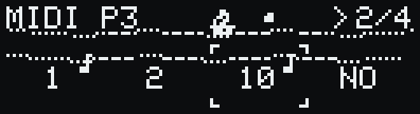
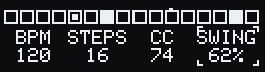
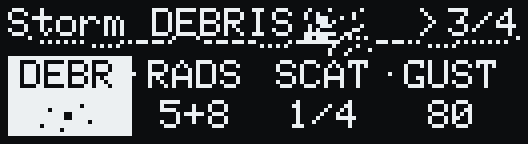
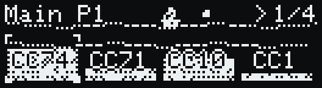
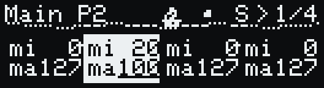

# Изменения

Что изменилось в RED SEA по сравнению с версией 1.0 (вышла 17.08.2026). English version: [CHANGELOG.md](CHANGELOG.md).

## 1.1 — бета

Ветка `beta`, в тестировании. Эту версию описывает [мануал](MANUAL.ru.md).

### Новое

- **MIDI-канал на каждый параметр.** Каждый из P1–P4 отправляет свой CC на свой канал, канал задаётся на странице MIDI: `NO` или 1–16. `NO` не отправляет вообще ничего.

  

- **Seq Trig.** Флаг на каждом параметре (TAP + вращение на странице MIDI, значок ноты). Ноты секвенсора, CC-колонка секвенсора, ноты арпеджио SUN и ноты TWST уходят на все каналы с включённым Seq Trig; повторяющиеся каналы — один раз.
- **Длина нот — LEN.** `LEG` — нота звучит до следующей, как в 1.0. `GATE` — нота гаснет на середине интервала до следующего удара. Действует на ноты и ретриги секвенсора, Freeze Roll, арпеджио SUN и TWST.
- **MIDI Learn учит и канал.** На странице MIDI он забирает из входящего сообщения и номер CC, и канал: покрутите ручку на треке драм-машины — и параметр будет отправлять ровно туда.
- **Freeze Roll.** Пока FREEZE удерживается кнопкой PLAY, вращение энкодера повторяет зацикленный шаг с частотой от 1/4 до 1/128. В окне — бар-тахометр, длина которого показывает частоту, огибающая каждого удара, шкала и лампа ударов. 1/64 и 1/128 отсчитываются точно, хотя попадают между тиками MIDI-клока; частоты, которые MIDI-линия при текущем темпе не успевает, приглушены.

  

- **Свинг.** TAP + вращение на колонке SCALE в setup секвенсора: 50–75 %, каждый второй шаг сдвигается позже, вплоть до полшага. Отсчитывается точно по времени, а не по тактам клока; GATE учитывает качнутые интервалы.

  

- **TWST** — пятая погода, управляемая MIDI-входом. Каждая входящая нота звучит сразу и разлетается копиями (DEBR) по окну (SCAT) и набору высот (RADS); каждый удар отбрасывает один из P1–P4 от базового значения, после чего тот плавно возвращается (GUST). Работает при остановленном секвенсоре.

  

### Изменено

- Страница CC теперь называется **MIDI**.
- Номера CC задаются на **MAIN через TAP + вращение**; пока TAP зажат, в колонках вместо значений подписаны `CC74`. Крупного шага ×12 с TAP на MAIN больше нет; на STORM и SEQUENCER он остался.

  

- Общей настройки **MIDI CH** больше нет; её колонку на подстранице MIDI заняла **LEN**.
- **Курсор шага секвенсора**: удерживайте энкодер и вращайте (вправо — вперёд). Старый жест — удержать энкодер и нажать TAP — убран: из-за него срабатывал 3-секундный сброс страницы.
- Поворот энкодера во время его удержания отменяет 3-секундный сброс — на любой странице.
- Пока зажат PLAY, энкодер никогда не меняет параметры.
- SUN, RAIN и SNOW отправляют CC параметра, только когда значение меняется (FOG так уже делал). При AMT 0 погода молчит и больше не перебивает другие CC на каждом шаге WAV.
- Рандомайз шага секвенсора ставит ноту в пределах октавы от текущей, а не в любое место 0–127. Рандомайз setup секвенсора больше не трогает темп.
- Подстраница MAIN (min/max): редактируемое значение подчёркнуто — min, а с зажатым TAP — max.

  

- Пока открыто окно Freeze Roll, экран обновляется 40 раз в секунду.
- Кораблик встаёт правее длинного заголовка страницы, а не поверх него.

### Исправлено

- Арпеджио SUN: новая серия отражений могла оставить предыдущую ноту арпеджио висеть.
- Подстраница MAIN: метка редактируемого значения рисовалась цветом заливки выбранной колонки — её не было видно, а цифры она частично стирала.
- Длинные заголовки (`NOTE LEN`, `SEQ DEST`, `RFLCT`, `ROTATE`, `DEBRIS`) частично закрывал кораблик.

### Тайминг и исправления после 1.0 — PR #3 от [@zemuro](https://github.com/zemuro) (Руслан Мазавин)

Уже в `main`.

- **Тайминг.** Такты, MIDI-вход и отправка идут в отдельной задаче, которая просыпается каждые 0,5 мс и точно к очередному внутреннему такту. Опоздание такта — с 23 мс до долей миллисекунды, а внутренний темп больше не проседает со временем (через несколько минут работы он отставал на 25 % на 120 BPM).
- **Экран.** Кадр уходит по I²C в отдельной задаче, и отрисовка больше не задерживает клок и MIDI.
- **Анимации** используют быстрый синус для больших аргументов — кадры больше не дорожают через несколько минут работы.
- **Clock наружу** при внутреннем темпе: Start при запуске двойным TAP, Clock на каждом такте, Stop при остановке. При внешнем клоке наружу ничего не уходит (MIDI thru нет).
- **Запуск секвенсора.** После Start первым звучит шаг 1. Внешний клок без Start больше не удваивает темп, если секвенсор запущен двойным TAP; под внешний клок секвенсор стартует со следующей доли.
- **Note Off.** Версия 1.0 не отправляла Note Off вовсе. Теперь нота звучит до следующей; Stop отправляет Note Off и All Notes Off (CC 123); вход в BYPASS гасит звучащие ноты. После BYPASS не уходит Note Off для нот, которые не покидали устройство.
- **Настройки.** Темп выше 255 BPM сохраняется правильно (раньше переходил в 0, 1, 2…). Сохраняются все четыре номера CC — раньше только тот, что под курсором, и номера, изменённые рандомайзом, сбросом или MIDI Learn, могли потеряться при выключении. Настройки пишутся через 2 с после последнего изменения, сразу после такта, чтобы запись не задерживала такты.
- **FOG**: нет случайного CC прямо перед значением LFO; LFO отправляет CC, только когда значение меняется.
- **Start** переносит капли RAIN, эхо SUN и заморозки SNOW к новому нулю счётчика тактов — раньше после Stop → Start RAIN молчал столько, сколько длился прошлый прогон.
- **MIDI Learn**: ожидание отменяет любая кнопка (TAP и PLAY не отменяли).
- **Энкодер**: щелчки не теряются при быстром вращении.
- **FREEZE**: анимация продолжается с того места, где встала.

### Документация

- Русские README и мануал, лицензия на документацию `LICENSE-DOCS` (CC BY 4.0).
- Скриншоты отрисованы собственным кодом отрисовки прошивки; `tools/screens/render.sh` пересобирает их.
- Инструкция по сборке: прошивка — скетч `REDSEA.ino`, собирается в Arduino IDE или через `arduino-cli`.

### Обновление с 1.0

Прошейте новую версию — настройки сохранятся. При первом включении прежний общий MIDI-канал копируется во все четыре параметра, Seq Trig включается у всех, LEN = `LEG`, так что устройство работает как раньше, пока вы сами не поменяете маршрутизацию. Параметры TWST начинают с 0.
